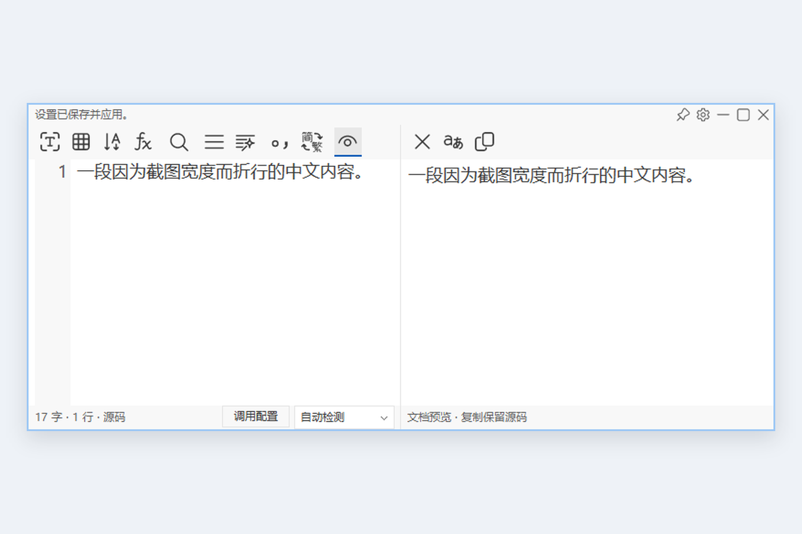
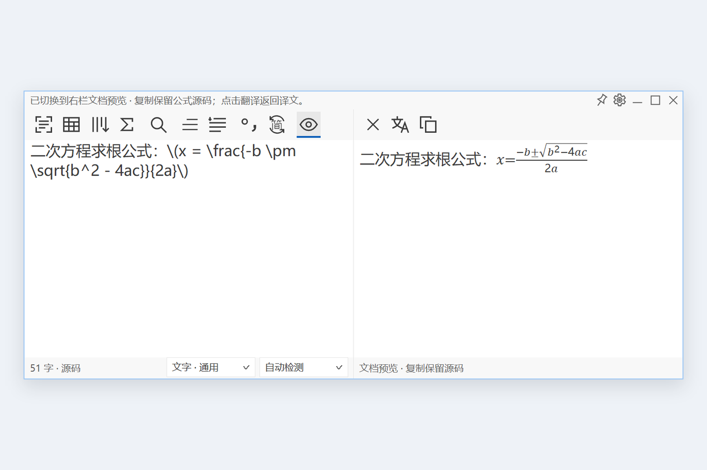
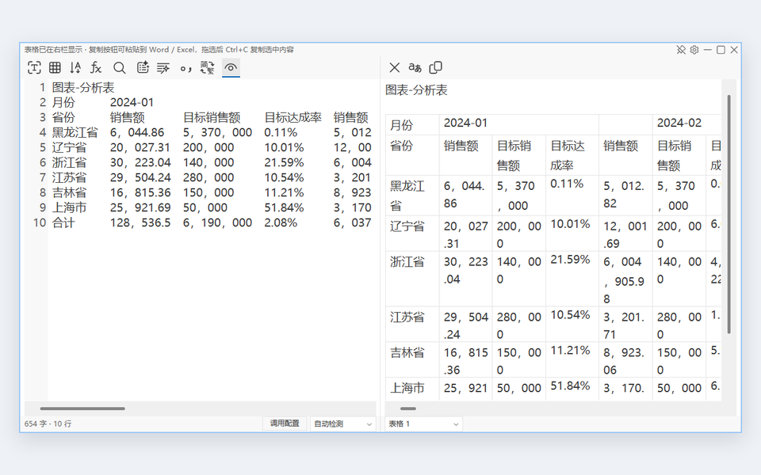
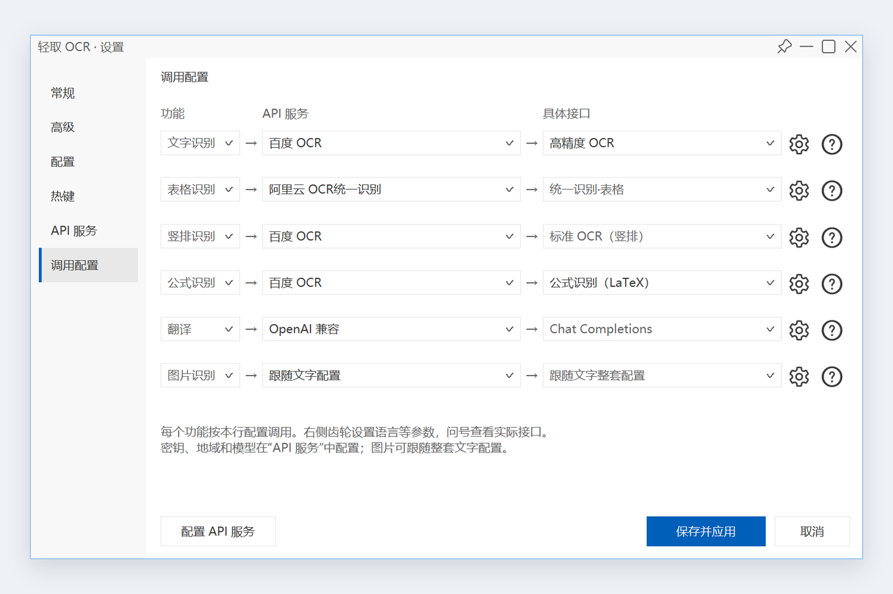
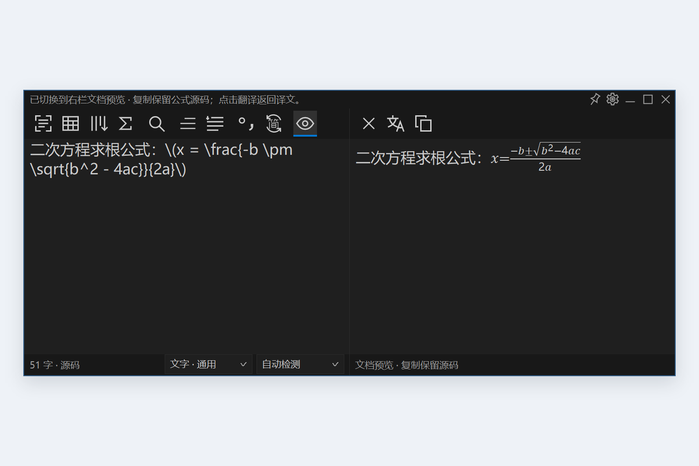
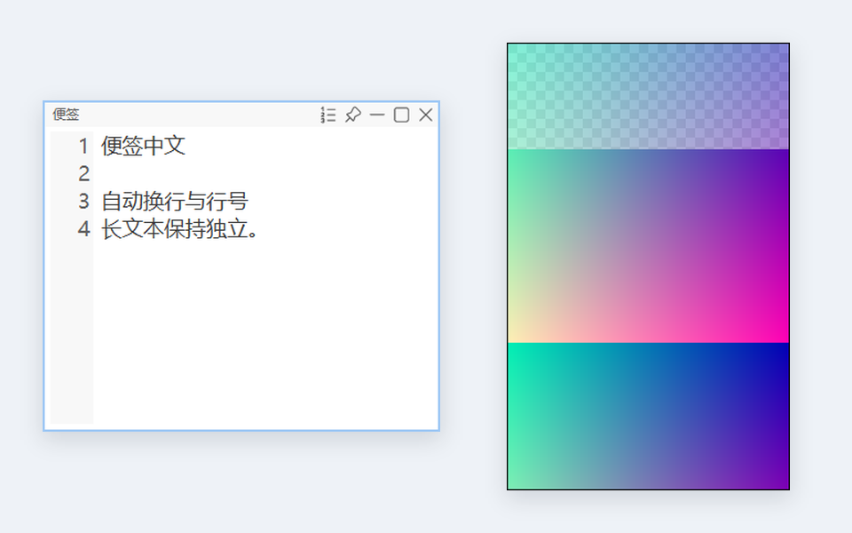

<p align="center">
  
</p>

<h1 align="center">Qingqu OCR</h1>

<p align="center">Capture text · Translate side by side · Format paragraphs · Pin images</p>

<p align="center">
  
  
  
  
</p>

<p align="center">
  <a href="README.md">简体中文</a> ·
  <a href="#getting-started">Getting started</a> ·
  <a href="#screenshots">Screenshots</a> ·
  <a href="#build-from-source">Build</a> ·
  <a href="#license">License</a>
</p>

Qingqu OCR is a Windows text recognition tool built with **Rust + Win32**. Capture screen content, edit and translate text, format paragraphs, preview formulas, and copy tables in one workspace. Clipboard text and images can also become independent desktop notes and pinned windows.

**OCR uses your configured cloud provider and requires network access and API permissions.** Original project materials are licensed for noncommercial purposes.

## Features

- **Screen OCR:** text, tables, vertical text, and formulas.
- **Translation:** two panes, multiple providers, automatic and streaming output.
- **Text tools:** editing, search, paragraphs, formatting, and Chinese/punctuation conversion.
- **Documents:** formula / Markdown previews and editable table copying to Word / Excel.
- **Clipboard windows:** text notes, pinned images, and independent OCR.
- **Desktop integration:** tray, shortcuts, floating toolbar, and light/dark themes.

## Screenshots

<table>
  <tr>
    <td align="center"><a href="docs/screenshots/workspace.png"></a><br><strong>Two-pane workspace</strong></td>
    <td align="center"><a href="docs/screenshots/formula-preview.png"></a><br><strong>Formula preview</strong></td>
  </tr>
  <tr>
    <td align="center"><a href="docs/screenshots/tables.png"></a><br><strong>Table recognition</strong></td>
    <td align="center"><a href="docs/screenshots/task-bindings.png"></a><br><strong>Task bindings</strong></td>
  </tr>
  <tr>
    <td align="center"><a href="docs/screenshots/dark-theme.png"></a><br><strong>Dark theme</strong></td>
    <td align="center"><a href="docs/screenshots/clipboard-windows.png"></a><br><strong>Text notes and pinned images</strong></td>
  </tr>
</table>

## Getting started

1. Extract `qingqu-ocr-0.3.0-windows-x64.zip` and run `qingqu-ocr.exe`. Fully exit the previous version from the tray before updating.
2. Open **Settings → API services** (`设置 → API 服务`). Enter your provider credentials and the required region, model, or endpoint.
3. Open **Settings → Task bindings** (`设置 → 调用配置`). Choose the task, service, and endpoint, then save and apply.
4. Press **`Alt+Q`** to capture text, or **`Alt+V`** to open clipboard text / images.

Image OCR can follow the text configuration or use its own binding. Cloud services may charge for requests; the application does not supply API keys. Available endpoints, languages, and account permissions depend on the provider.

### Supported services

<table>
  <thead><tr><th>Category</th><th>Service</th><th>Capabilities</th></tr></thead>
  <tbody>
    <tr><th colspan="3" align="left">OCR recognition</th></tr>
    <tr><td rowspan="6">OCR</td><td>Baidu OCR</td><td>Text, tables, vertical text, formulas, and document analysis</td></tr>
    <tr><td>Tencent Cloud OCR</td><td>Text, tables, and vertical text</td></tr>
    <tr><td>Alibaba Cloud standalone OCR</td><td>General text, high-accuracy documents, tables, and formulas</td></tr>
    <tr><td>Alibaba Cloud unified OCR</td><td>Text, handwriting, multilingual text, and tables</td></tr>
    <tr><td>Model Studio Qwen-OCR / Qwen-VL</td><td>Text, tables, vertical text, and formulas according to model capabilities</td></tr>
    <tr><td>Mathpix</td><td>Formula recognition</td></tr>
    <tr><th colspan="3" align="left">Text translation</th></tr>
    <tr><td rowspan="7">Translation</td><td>Google</td><td>Web service / official API</td></tr>
    <tr><td>Microsoft</td><td>Web service / official API</td></tr>
    <tr><td>Index Translate</td><td>Separate endpoint, model, and key settings</td></tr>
    <tr><td>OpenAI-compatible</td><td>Custom compatible endpoints, models, and streaming</td></tr>
    <tr><td>Baidu Translate</td><td>Official translation API</td></tr>
    <tr><td>Alibaba Cloud Translate</td><td>Official translation API</td></tr>
    <tr><td>Tencent Translate</td><td>Official translation API</td></tr>
  </tbody>
</table>

Use the **“?” button** in the application for each service's endpoint, configuration, and quota information.

### Default shortcuts

| Shortcut | Action |
|---|---|
| `Alt+Q` | Capture text from the screen |
| `Alt+V` | Open current clipboard text / images |

Assign shortcuts to other actions in Settings as needed.

<details>
<summary><strong>Formatting, tables, and image workflows</strong></summary>

- **Paragraphs:** Automatic mode uses reading order, alignment, spacing, and reliable provider hints. Split mode retains OCR lines; merge mode removes all line breaks. Smart formatting separately processes current text or selection without changing the default mode for later OCR. Externally pasted text can be merged into one line and restored or reorganized with paragraph controls.
- **Text protection:** Formatting protects code, formulas, URLs, and related structures. Settings control indentation and paragraph spacing. Manual edits are not overwritten by stale recognition content.
- **Table copying:** Whole tables and selections provide RTF, Excel XML Spreadsheet, and TSV, preserving cell line breaks, merged spans, leading zeros, and long identifiers. Review provider mistakes, missing cells, and incorrect merges.
- **Formulas / Markdown:** Common fractions, roots, scripts, headings, lists, and code are supported. Math delimiters include `$...$`, `$$...$$`, `\(...\)`, and `\[...\]`. HTML is displayed literally; scripts and remote images are not loaded. Complex TeX macros are not guaranteed. Previews exceeding 256 KiB or 8192 formatting spans fall back to source.
- **Pinned images:** Manual scale ranges from 1–800%, with smooth wheel zoom, rotation, fit-to-screen, pinning, information bars, and explicit OCR. Display zoom does not change original pixels. Recognition uses the full original with its current rotation; copying excludes borders and information bars.
- **Image copying:** Lossless PNG, DIBV5, file-list, and path-text formats are offered together. The receiving application chooses a supported format; a text-only target may receive the PNG path.
- **Sessions:** Content and undo histories remain while the app is in the tray and end when the process exits. Identical images can share the original while retaining per-window rotation.

</details>

## Data and privacy

OCR images and translation text are sent to your chosen services. Automatic translation also sends recognized text to the configured translation provider. **Opening clipboard notes or images with `Alt+V` does not itself upload content.**

Preferences are stored at `%LOCALAPPDATA%\QingquOCR\settings.json`; Windows DPAPI encrypts credentials in `credentials.bin` in the same directory. `QINGQU_DATA_DIR` selects a separate data directory. Keys can be shown or hidden in Settings; do not share credential files or screenshots containing keys.

<details>
<summary><strong>Local images and temporary files</strong></summary>

Original images and undo records use session temporary files. An original is removed after its final window/task reference is released. Copying an image leaves a PNG in the system temporary directory `QingquOCR-clipboard` so its path remains usable after exit. Later successful copies remove files older than seven days and aim for a cache limit of 128 images / 128 MiB. Current or locked files may temporarily exceed those limits. Copied sensitive images can therefore remain after exit.

</details>

## Lightweight design

This section documents the implementation for developers and maintainers: **resource accounting, data lifetimes, rendering, scheduling, and measurement boundaries**. The objective is to remove redundant state, constrain resources that can accumulate, and shorten transient allocation lifetimes. A smaller number in Task Manager is not sufficient evidence of an optimization.

### 1. Resource model and metrics

Resources fall into four groups: resident windows and worker threads; editor buffers and current history state that scale with text length; file mappings that scale with unique images; and temporary frames, encoding buffers, and network payloads that scale with active viewports and jobs. These have different growth variables and cannot share one meaningful "cache limit."

An RGBA original requires `4WH` bytes for `W × H` pixels. A 32-bit display DIB requires approximately `4VwVh` bytes for viewport dimensions `Vw × Vh`. One 3840 × 2160 pixel buffer is **31.64 MiB**. Whole frames and system compositor surfaces can therefore dominate interaction peaks even when filter tiles occupy only hundreds of KiB.

| Resource | Implemented bound | Excluded resources |
|---|---|---|
| Settled display cache | 4 MiB shared by the UI thread, with byte-budget eviction | Original mappings, animation frames, system compositor surfaces |
| Filter output tile | At most 1024 × 64 × 4, or 256 KiB | Input tiles, convolution support, library workspace |
| Waiting jobs | One pending job per worker lane | Running jobs, result notifications, payload byte size |
| Undo journal | Deltas and linked metadata stored in a session file | Current text, editor storage, operation-group snapshots |
| Document preview input | 256 KiB source; at most 8192 planned spans | Control state, parsing allocations, format-application costs |

**The 4 MiB value is a display-cache policy, not a total-process memory guarantee.** Mapped pages, graphics resources, and shared system pages affect residency. Private Working Set, Private Bytes, and Working Set measure different things.

### 2. UI responsibilities and redundant state

Statically linked Scintilla owns plain-text layout, wrapping, scrolling, and its internal line-number margin. The application changes the margin only when the computed width changes, avoiding a second line-number renderer and scroll synchronization model. The adapter explicitly translates between UTF-8 byte offsets and Windows UTF-16 selection units. [Implementation: Scintilla adapter](src/native/scintilla.rs), [editor view](src/native/editor_view.rs).

`DocumentView` lazily creates the system Rich Edit / TOM2 preview. A rebuild constructs a formatting plan, disables redraw, applies formatting in a batch, and restores redraw once. The read-only preview disables internal undo, while copying retains the separate source representation. A preview that has been created can still retain its control and COM state; hiding it does not unload system modules. [Implementation: document preview](src/native/rendered.rs).

### 3. Original-image ownership and mappings

`StoredImage::intern` indexes candidates by `(width, height, MD5)` and confirms matches by comparing actual pixel bytes. Hashes select candidates rather than establish equality. The index stores `Weak<StoredImage>`; windows and jobs hold `Arc<StoredImage>`, so the index cannot keep an unused original alive. `ImageView` adds rotation and source-size metadata without retaining a full rotated image for each window.

Initial insertion writes RGBA bytes to a session file opened with `FILE_FLAG_DELETE_ON_CLOSE`, then creates a read-only `CreateFileMappingW` object. `MapViewOfFile(FILE_MAP_READ)` exposes pixels when required. A short-lived `Pixels` view unmaps on drop; `MappedPixels` retains the view and a strong original reference throughout continuous zoom, reducing per-frame mapping and page-refault work. The final strong reference releases mapping and file handles. Display entries use weak ownership and are removed after the last pin closes even if an OCR job still needs the original. [Implementation: image storage](src/image_store.rs), [session files](src/session_file.rs).

This is not end-to-end zero-copy. Decoded `RgbaImage` storage exists before insertion; hashing and comparison traverse pixels; rotated copying and OCR materialization may allocate whole images. Mapping replaces duplicated long-lived heap storage with shared file-backed pages, at the cost of temporary disk I/O and page faults.

### 4. Delta-based undo journals

The application `Journal` owns undo history and disables the editor's internal undo storage. Given adjacent texts `A` and `B`, it finds their common prefix and suffix, adjusts both boundaries to valid UTF-8 character boundaries, and writes only removed and inserted middle regions. Each record has an **80-byte header** containing linked offsets, delta position and lengths, selections, paste state, and paragraph-source offsets. Record size is approximately `80 + removed_bytes + inserted_bytes`.

Linked navigation metadata also lives in the file rather than one in-memory node per operation. Streaming translation and paragraph commands group updates into one final delta and one undo action. Ordinary input messages inspect the modification flag first, avoiding a full read when a key or IME message did not change text. [Implementation: undo journal](src/native/history.rs).

The reduction applies to the accumulated history chain. The editor buffer, `Journal.current`, and required operation-group snapshots still occupy memory. An actual modification can still require `O(N)` text retrieval and prefix/suffix scanning, and journal I/O runs on the UI message path. Abandoned redo records are not compacted online. Long-document responsiveness and session-file growth remain technical debt.

### 5. Tiled resampling and display-cache policy

The adapter uses `fast_image_resize 6.1.0`, runtime CPU instruction dispatch, and `Convolution(Bilinear)`, without Rayon. The support region expands for reduction; enlargement and reduction preserve one pixel-center transform. Fractional window-position rounding is retained in `phase` and included in sampling, preventing each frame from reconstructing its transform from integer geometry alone.

Output tiles use `columns = clamp(floor(512 × zoom), 1, 1024)` and `rows = clamp(floor(512 × zoom), 1, 64)`. Unrotated interior tiles borrow original rows; rotated or boundary-extended tiles materialize only the current source region. `render_strided` writes tile results into the destination DIB's row stride, avoiding another complete resized image and subsequent full-image copy. The 256 KiB bound covers output tile bytes only: support regions vary with reduction ratio, and input/library workspaces remain additional allocations. [Implementation: adapter](src/native/picture/resample.rs), [tiled convolution](vendor/picture-renderer/src/lib.rs).

Settled display frames use a `VecDeque` with LRU-like behavior. Keys include original identity, rotation, viewport, exact scale bits, translation, fractional phase, and background. Hits move to the back; budget pressure evicts from the front. Frames exceeding 4 MiB bypass the cache, and intermediate animation frames cannot evict settled entries. Active interactions reuse mappings, DIBs, and filter workspace, then release temporary objects on stop. [Implementation: picture window](src/native/picture.rs).

### 6. Zoom control, stable surfaces, and submission

Wheel packets update a target scale instead of queuing rendered frames: `target *= 1.1^(delta/120)`. Animation converges in log-scale space using elapsed time: `z_next = z × exp(ln(target/z) × (1 - exp(-dt/0.060)))`. It finishes when the error is sufficiently small or 240 ms have passed since the last input. A fixed source anchor is retained while the pointer stays in place. Timers run only during animation; frames taking longer than roughly 1/60 second re-arm the timer to leave time for input processing. This is not a universal 60 FPS guarantee.

Each frame is drawn into a DIB before `UpdateLayeredWindow` submits position, dimensions, and pixels together. This avoids exposing new window geometry with the previous image. A scoped `PreparedFrame` window property exposes an immutable completed frame to synchronously reentrant paint messages, without borrowing mutable `Picture` state again. The property is removed when the scope ends. Failed uploads discard reserved geometry and fall back to complete-frame GDI drawing.

When visible dimensions change during zoom, the logical visible rectangle is separated from the backing surface. Reservation predicts the next `1.25^k` scale bucket and uses a **256 px grid**. Image, one-pixel frame, information bar, and 16 px shadow are composed into one surface, with transparent padding remaining click-through. Stop/cancel compacts the surface; fixed viewports do not need the same growth path. A previous envelope is retained only if its union stays within 32 MiB and within 4 MiB of the current reservation. **This condition does not cap a fresh reservation or aggregate allocations across windows.** [Implementation: presentation and canvas](src/native/picture.rs), [shadow composition](src/native/picture_shadow.rs).

Stable surfaces reduce geometry mismatch and repeated surface creation, but increase transparent-region clearing, alpha repair, and layered-upload work. Large viewports still require full-frame DIBs, and Windows can retain additional compositor surfaces. Tiling the filter does not remove those costs.

### 7. Bounded pending jobs and result ordering

Local work, OCR, and translation use three fixed worker lanes. Each thread consumes a `Mutex<(closed, Option<Job>)> + Condvar` mailbox with at most one waiting job. Replacing that job marks it cancelled and releases its inputs. This bounds the **pending count**, excluding three potentially running jobs, payload sizes, and the `mpsc` notification queue.

Increasing job IDs and `Arc<AtomicBool>` cancellation flags prevent stale results from overwriting newer text after editing or replacement. Streaming progress uses one shared `Option<(id, String)>` latest-value slot; the UI takes the newest complete state instead of enqueuing every accumulated string. Progress still requests a wakeup, and constructing full strings still has length-dependent cost. [Implementation: worker lanes](src/native/backend.rs), [result delivery](src/native/main_window/jobs.rs).

Cancellation is cooperative. A blocking network request already in flight can occupy its lane until response or timeout despite the flag. Idle threads wait on a condition variable; a 60-second timeout releases the Baidu HTTP client while independently retaining a token matched to credentials and expiry. This reduces idle connection retention but is not a no-wakeup design. [Implementation: authentication and connections](src/ocr.rs).

### 8. Capture, upload, and clipboard memory boundaries

Capture uses checked multiplication, an `isize::MAX` check, and `try_reserve_exact`, preserving monitor resolution and reporting system allocation failure. A frozen capture can still have both an RGBA vector and a GDI bitmap alive. Cropping, OCR decoding, and network wrapping can add temporary copies. Removing a fixed capture budget does not remove those allocations. [Implementation: capture](src/platform.rs).

OCR preparation is separate from display filtering. Provider policies constrain dimensions, pixel count, and actual PNG bytes. Transparency is composited onto white in the existing RGBA buffer, then encoded as PNG Level 3 / Adaptive, avoiding a whole RGB conversion copy. A `Limited` writer aborts at the byte budget; only overflow triggers reduction and retry. Area-average reduction directly produces the destination rather than retaining a full-width floating-point intermediate. Base64, JSON, and form escaping remain extra costs, so a PNG limit is not a whole-request peak limit. [Implementation: upload preparation](src/ocr/input.rs).

Clipboard PNG exports use a separate disk cache. Reuse checks compare contents in 16 KiB chunks, and the application retains only the most recent export's protective file handle. Seven-day, 128-file, and 128 MiB targets are enforced on subsequent successful copies; current and locked files can exceed them temporarily. This disk cache is distinct from display caching and reference-owned session originals. [Implementation: export cache](src/platform/clipboard_cache.rs).

### 9. Build configuration and hot-path isolation

The application Release profile uses `opt-level = "s"`, Thin LTO, one codegen unit, symbol stripping, and `panic = "abort"`. `fast_image_resize` and the local adapter separately use `opt-level = 3`, reserving speed optimization for the hot loops rather than expanding the entire executable. Dependencies enable only required image formats and protocol features, while Scintilla is linked statically. [Configuration: Cargo.toml](Cargo.toml), [build script](build.rs).

These are tradeoffs: LTO and one codegen unit increase build time; static CRT reduces deployment dependencies rather than individual allocations. Aborting panics avoid unwinding but also skip Rust destructors. Normal RAII cleanup and abnormal termination therefore require separate reasoning; using Rust alone does not prove application cleanup completes on every failure path.

### 10. Measurements and remaining technical debt

The measured artifact is the current 2026-11-08 Release. Conditions: this machine, isolated desktop and preferences, empty two-pane window and floating toolbar, no OCR/translation/clipboard writes, no working-set trimming. Two approximately 3.002-second samples agreed:

| Metric | Observation | Meaning |
|---|---:|---|
| Working Set | 33.27 MiB | Resident private and shareable pages |
| Private Working Set | 5.01 MiB | Resident pages not shareable with other processes |
| Private Bytes | 6.54 MiB | Private committed memory, not necessarily resident |
| Idle CPU | 0.0% | Process CPU-time delta / wall time, normalized to one logical core |
| GDI / USER objects | 97 / 87 | Identical across these samples, not proof of long-run leak freedom |

Zero in two short intervals means no CPU-time increase was observed at the sampled precision, not absolute absence of wakeups. These measurements exclude image interaction, first preview creation, and real cloud requests. They also cannot attribute improvements to individual changes without before/after runs using the same inputs and build conditions.

Remaining debt and validation work:

1. **Deduplication critical sections and whole-image costs.** A full input exists before hashing; candidate comparisons and initial file writes occur under the global index lock. Concurrent insertion needs lock-duration profiling and separation of movable I/O/comparison work. Acceptance should cover identical-image hits, distinct concurrent inputs, and peak commit.
2. **Incremental text changes.** Translating Scintilla modification notifications into exact insertion/deletion records could replace current full-text retrieval and scans. It must preserve UTF-8/UTF-16 selection conversion, IME behavior, grouped undo, paragraph-source consistency, and redo-file reclamation.
3. **Full-frame work on the UI thread.** SIMD and buffer reuse do not move convolution off the UI thread, and layered submission still scales with surface area. Record input-to-submit p50/p95/p99, filter time, upload time, and active peak allocation separately rather than reporting mean frame rate alone.
4. **Unified cancellation and transient-resource budgets.** Single-slot mailboxes bound count only. Blocking requests, an unbounded notification channel, and multiple active pins can retain large payloads. Interruptible requests, notification backpressure, and byte-based active-job budgets need validation against stale-result overwrites.
5. **Win32/FFI lifetime auditing.** Mapping views, DIB/DC objects, temporary pointers in window properties, and synchronous reentrancy depend on explicit ownership invariants. Destruction, allocation failure, and fallback paths need handle-recovery checks against a warmed baseline, including file mappings and system compositor resources.

## Build from source

### Requirements

| Item | Requirement |
|---|---|
| Rust / Cargo | **1.97.1 or newer stable**; both the application and local renderer declare `rust-version = "1.97.1"` |
| Target | `x86_64-pc-windows-msvc`, Rust 2021 Edition |
| C++ toolchain | Visual Studio 2022 Build Tools or newer, with Desktop development with C++, MSVC x64/x86 tools, and C++17 support |
| Windows SDK | Windows 10 / 11 SDK; the current build uses **10.0.26100.0** |
| Release packaging | PowerShell **7.0+**; compiling the executable needs no additional packaging tool |

Rust 1.97.1 is the currently declared and verified minimum supported version. See the [official rustup MSVC instructions](https://rust-lang.github.io/rustup/installation/windows-msvc.html) for installing the native toolchain.

### Install the toolchain and fetch dependencies

Install [rustup](https://rustup.rs/) and the C++ tools above, then run these commands from the repository root:

```powershell
rustup toolchain install stable-x86_64-pc-windows-msvc --profile minimal --component rustfmt --component clippy
rustc +stable-x86_64-pc-windows-msvc --version
cargo +stable-x86_64-pc-windows-msvc fetch --locked --target x86_64-pc-windows-msvc
```

Confirm that Rust is at least 1.97.1. The first fetch needs network access. [Cargo.lock](Cargo.lock) fixes the dependency versions, while [Cargo.toml](Cargo.toml) declares runtime and build dependencies. Cargo installs the Rust libraries automatically.

### Compile and run

Use **Developer PowerShell for Visual Studio**, or PowerShell with the MSVC environment configured:

```powershell
cargo +stable-x86_64-pc-windows-msvc build --release --locked
.\target\release\qingqu-ocr-native.exe
```

The build produces `target/release/qingqu-ocr-native.exe`, distributed as `qingqu-ocr.exe`. `.cargo/config.toml` enables static CRT, and a C++17 compiler builds Scintilla into the executable. Once dependencies are cached, add `--offline` to build without network access.

### Checks and packaging

```powershell
cargo +stable-x86_64-pc-windows-msvc fmt --all -- --check
cargo +stable-x86_64-pc-windows-msvc check --locked
cargo +stable-x86_64-pc-windows-msvc clippy --locked -- -D warnings
pwsh -File scripts/package.ps1
```

The packager reads the compiled executable and locked dependencies, verifies third-party notices, and creates a Windows x64 ZIP and SHA-256 file in `dist/`. The package includes the executable, bilingual READMEs, screenshots, and licenses. Existing ZIPs are not overwritten.

<details>
<summary><strong>Dependencies and source layout</strong></summary>

Cargo retrieves registry libraries. The following local materials are already included:

- `vendor/scintilla/`: Scintilla 5.6.9 core, headers, and Win32 sources.
- `vendor/picture-renderer/`: the project's Rust image-rendering adapter.
- `vendor/text-layout/`: attribution and licenses for adapted algorithms; their Rust implementation is in `src/text/`.
- `assets/`: SVGs, themes, application icons, and Windows manifest used by the build.

Key dependencies and purposes, using versions from the current lockfile:

| Purpose | Dependencies |
|---|---|
| Windows interfaces | `windows 0.62.2`, `windows-sys 0.61.2` |
| Images and clipboard | `image 0.25.10`, `fast_image_resize 6.1.0`, `arboard 3.7.0` |
| Network and async requests | `reqwest 0.13.5`, `tokio 1.54.1`, `async-openai 0.42.3` |
| Document parsing | `pulldown-cmark 0.13.6`, `quick-xml 0.41.0` |
| Formatting and conversion | `ferrous-opencc 0.4.0`, `regex 1.13.1`, `textwrap 0.16.4`, `unicode-segmentation 1.13.3` |
| Configuration and data | `serde 1.0.229`, `serde_json 1.0.154`, `secrecy 0.10.3`, `base64 0.22.1`, `md5 0.8.1`, `futures-util 0.3.34` |
| Build resources | `cc 1.10.0`, `resvg 0.49.0`, `winresource 0.1.34` |

Use `cargo tree --locked` to inspect all transitive dependencies. Registry crate sources are not all copied into this repository; Cargo lock metadata and `licenses/` retain version, origin, and license information.

| Path | Contents |
|---|---|
| `src/native/` | Main window, notes, images, settings, and editor |
| `src/config/`, `src/ocr/`, `src/ocr_cloud/` | Task configuration and recognition adapters |
| `src/platform/`, `src/text/` | Capture, clipboard, formatting, and conversion |
| `licenses/`, `docs/screenshots/` | Third-party notices and UI examples |

</details>

## Feedback and contributions

Include Windows / application versions, DPI, provider/model, reproduction steps, and expected behavior when reporting an issue. Attach a minimal nonsensitive sample. Do not submit API keys, `credentials.bin`, or private source documents. Read project and third-party licenses before contributing and run the basic checks above.

## License

Original code, documentation, and original artwork that the author has authority to license use **[PolyForm Noncommercial 1.0.0](LICENSE)**. **Commercial use of those materials is not granted.** Source availability is subject to that license's permitted purposes.

Third-party components retain their own licenses and the commercial-use rights those licenses grant. Project noncommercial terms do not replace third-party MIT, Apache-2.0, BSD, or other applicable licenses. Umi-OCR / GapTree-derived portions retain MIT attribution. Preserve applicable notices in [NOTICE.txt](NOTICE.txt), [THIRD_PARTY_NOTICES.txt](THIRD_PARTY_NOTICES.txt), and [licenses/](licenses/) when distributing.

Thanks to the maintainers of Scintilla, Umi-OCR / GapTree, fast_image_resize, Fluent UI System Icons, VS Code, Catppuccin, and the Rust ecosystem.
