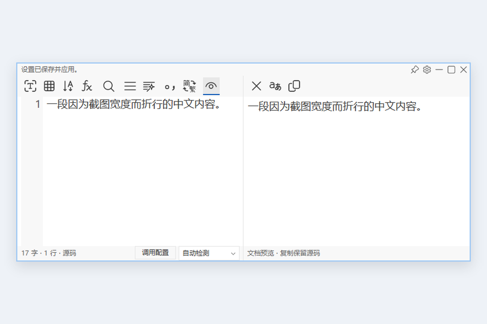
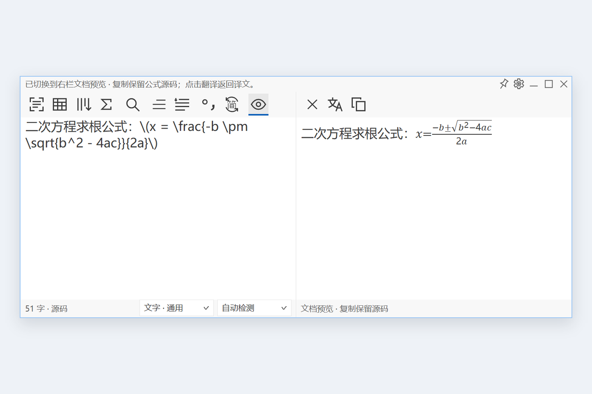
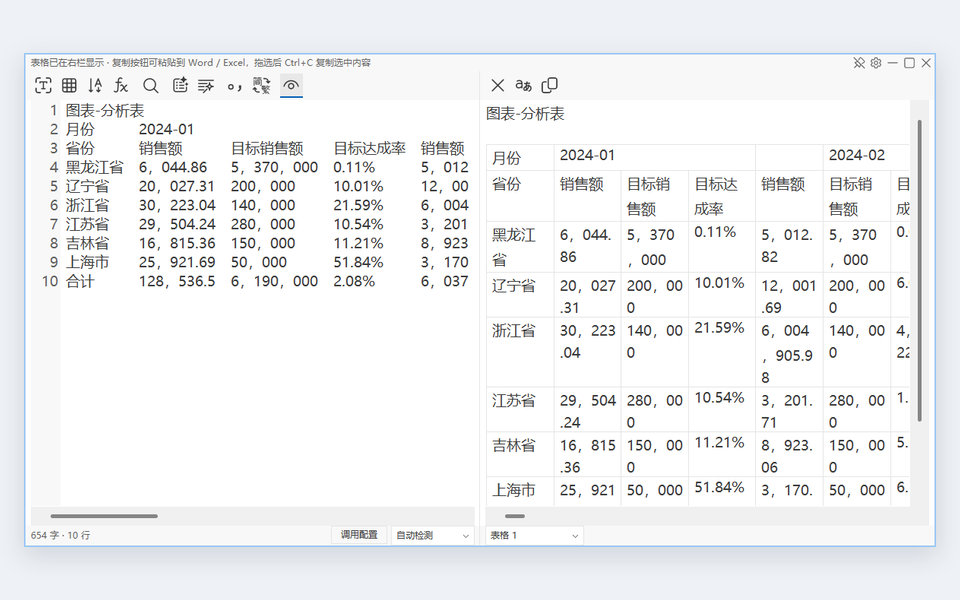
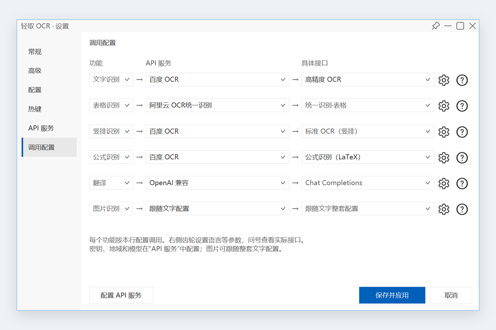
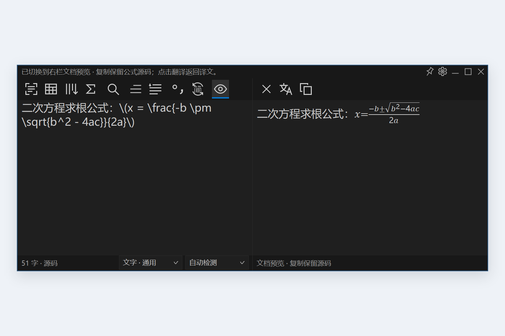
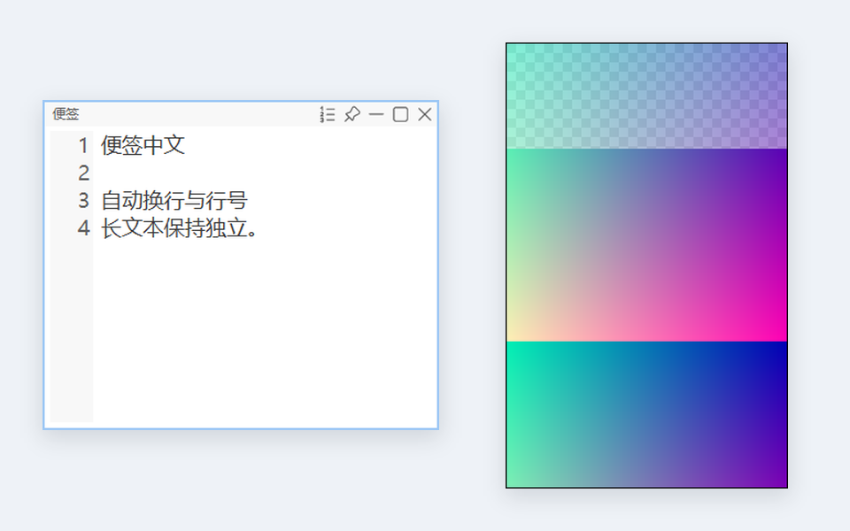

<p align="center">
  
</p>

<h1 align="center">轻取 OCR</h1>

<p align="center">截图取字 · 双栏翻译 · 智能排版 · 图片悬浮</p>

<p align="center">
  
  
  
  
</p>

<p align="center">
  <a href="README.en.md">English</a> ·
  <a href="#开始使用">开始使用</a> ·
  <a href="#界面预览">界面预览</a> ·
  <a href="#从源码构建">构建</a> ·
  <a href="#许可证">许可证</a>
</p>

轻取 OCR 是一款使用 **Rust + Win32** 开发的 Windows 桌面文字识别工具：从屏幕提取文字，在同一工作区完成编辑、翻译、排版、公式预览和表格复制，也可以将剪贴板内容固定为桌面便签或图片浮窗。

应用使用 Scintilla、系统 Rich Edit 和 GDI，解压即可运行。**OCR 通过你配置的云服务完成，需要网络及对应 API 权限。** 原创代码采用非商业许可。

## 主要功能

| 功能 | 说明 |
|---|---|
| 截图取字 | 冻结当前显示器，预选窗口或拖动框选；支持文字、表格、竖排与公式任务 |
| 双栏翻译 | 原文与译文并排显示，支持单次翻译、自动翻译、目标语言切换及兼容接口的流式输出 |
| 文本编辑 | 行号、自动折行、查找、选区操作、字号调整，以及原文和译文各自的撤销 / 重做 |
| 排版与转换 | 自动分段、保留原始行、段落合并、智能排版、中英文标点、简繁转换、缩进与段间空行 |
| 公式与 Markdown | 左栏编辑源码，右栏原生预览；复制时保留 LaTeX / Markdown 源码 |
| 表格复制 | 预览多张表格，保留空白格、合并跨度及标题脚注；复制到 Word / Excel 后继续编辑 |
| 便签与图片 | `Alt+V` 打开当前剪贴板内容；图片支持缩放、旋转、拖动、置顶、信息栏及独立 OCR |
| 按任务配置 | 文字、表格、竖排、公式、翻译和图片分别绑定服务与接口，互不覆盖 |
| 桌面集成 | 托盘、全局热键、悬浮工具条、开机启动、单实例及 VS Code Modern / Catppuccin 浅深主题 |

## 界面预览

<table>
  <tr>
    <td align="center"><a href="docs/screenshots/workspace.png"></a><br><strong>双栏工作区</strong></td>
    <td align="center"><a href="docs/screenshots/formula-preview.png"></a><br><strong>公式预览</strong></td>
  </tr>
  <tr>
    <td align="center"><a href="docs/screenshots/tables.png"></a><br><strong>表格识别</strong></td>
    <td align="center"><a href="docs/screenshots/task-bindings.png"></a><br><strong>调用配置</strong></td>
  </tr>
  <tr>
    <td align="center"><a href="docs/screenshots/dark-theme.png"></a><br><strong>深色主题</strong></td>
    <td align="center"><a href="docs/screenshots/clipboard-windows.png"></a><br><strong>图片浮窗与右键菜单</strong></td>
  </tr>
</table>

## 开始使用

1. 解压 `qingqu-ocr-0.3.0-windows-x64.zip`，运行 `qingqu-ocr.exe`。更新前先从托盘彻底退出旧版。
2. 打开 **设置 → API 服务**，填写你要使用的服务凭据，以及所需的地域、模型或地址。
3. 打开 **设置 → 调用配置**，按“功能 → API 服务 → 具体接口”选择各任务的绑定，保存并应用。
4. 按 **`Alt+Q`** 截图识别，或按 **`Alt+V`** 打开剪贴板文字 / 图片。

图片识别可以跟随文字配置，也可以独立设置。云服务可能收费，程序不提供 API Key；可用接口、语言及账户权限由服务商决定。

### 支持的服务

<table>
  <thead><tr><th>类别</th><th>服务</th><th>支持内容</th></tr></thead>
  <tbody>
    <tr><th colspan="3" align="left">OCR 识别</th></tr>
    <tr><td rowspan="6">OCR</td><td>百度 OCR</td><td>文字、表格、竖排、公式及文档分析</td></tr>
    <tr><td>腾讯云 OCR</td><td>文字、表格、竖排</td></tr>
    <tr><td>阿里云 OCR 独立接口</td><td>通用文字、高精度文档、表格、公式</td></tr>
    <tr><td>阿里云 OCR 统一识别</td><td>文字、手写、多语言、表格</td></tr>
    <tr><td>百炼 Qwen-OCR / Qwen-VL</td><td>按模型能力提供文字、表格、竖排与公式识别</td></tr>
    <tr><td>Mathpix</td><td>公式识别</td></tr>
    <tr><th colspan="3" align="left">文字翻译</th></tr>
    <tr><td rowspan="7">翻译</td><td>Google</td><td>网页服务 / 官方 API</td></tr>
    <tr><td>Microsoft</td><td>网页服务 / 官方 API</td></tr>
    <tr><td>Index Translate</td><td>独立地址、模型与密钥配置</td></tr>
    <tr><td>OpenAI 兼容</td><td>自定义兼容地址、模型及流式输出</td></tr>
    <tr><td>百度翻译</td><td>官方翻译 API</td></tr>
    <tr><td>阿里云翻译</td><td>官方翻译 API</td></tr>
    <tr><td>腾讯翻译</td><td>官方翻译 API</td></tr>
  </tbody>
</table>

各服务的接口、配置和额度说明，可点击软件中的 **“？”按钮** 查看。

### 默认快捷键

| 快捷键 | 操作 |
|---|---|
| `Alt+Q` | 截图识别 |
| `Alt+V` | 打开当前剪贴板文字 / 图片 |

其他功能可在设置中按需分配快捷键。

<details>
<summary><strong>排版、表格和图片的使用说明</strong></summary>

- **段落处理：** 自动分段结合阅读顺序、对齐、行距和可靠的接口信息；拆分保留原始 OCR 行，合并去掉全部换行。智能排版独立处理当前文字或选区，不改变后续识别的默认模式。外部粘贴文字可一键合并为一行，再用段落按钮恢复或整理。
- **文本保护：** 智能排版保护代码、公式、网址等结构；首行缩进、段间空行由设置控制。手工编辑后不使用旧识别内容覆盖当前文字。
- **表格复制：** 支持整表与选区，提供 RTF、Excel XML Spreadsheet 和 TSV，保留单元格换行、合并跨度、前导零及长编号。表格结构依赖云端返回结果，错字、漏格和错误合并仍需核对。
- **公式 / Markdown：** 支持常见分数、根式、上下标、标题、列表和代码。数学分隔符包括 `$...$`、`$$...$$`、`\(...\)`、`\[...\]`。HTML 按文字显示，不执行脚本或加载网络图片；复杂 TeX 宏不保证兼容。超过 256 KiB 或 8192 个格式片段时回退源码。
- **图片浮窗：** 支持 1–800% 手动比例、平滑滚轮缩放、左右旋转、适应屏幕、置顶、信息栏和主动识别。显示缩放不改变原图；识别使用完整原图并保留旋转方向，复制不包含边框或信息栏。
- **图片复制：** 同时提供无损 PNG、DIBV5、文件列表和路径文字，目标软件选择其支持的格式。纯文字目标可能收到 PNG 文件路径。
- **会话：** 收进托盘后保留内容与撤销记录；彻底退出后结束本次会话。相同图片可共享原图，各窗口分别记录旋转状态。

</details>

## 数据与隐私

OCR 图片和待翻译文字发送到你选择的服务；开启自动翻译后，识别结果会继续提交给翻译服务。**`Alt+V` 打开便签或图片本身不上传内容。**

偏好设置保存在 `%LOCALAPPDATA%\QingquOCR\settings.json`，凭据由 Windows DPAPI 加密，保存在同目录的 `credentials.bin`。可通过 `QINGQU_DATA_DIR` 指定独立数据目录。密钥可在配置页显示或隐藏，请勿分享含密钥的截图或凭据文件。

<details>
<summary><strong>本地图片和临时文件</strong></summary>

原图与撤销记录使用会话临时文件；原图在最后一个窗口或任务释放引用后清理。为使复制出的文件路径在退出后仍可用，图片复制会在系统临时目录 `QingquOCR-clipboard` 保留 PNG。后续成功复制时清理 7 天前的旧文件，并以 128 张 / 128 MiB 为缓存目标；当前或被占用文件可能暂时超限。复制过的敏感图片可能在退出后继续保留。

</details>

## 从源码构建

需要 **Rust MSVC 工具链、Visual Studio C++ Build Tools（C++17）和 Windows SDK**。当前构建使用 Rust 1.97.1，未声明最低 Rust 版本。

在已配置 MSVC 开发环境的 PowerShell 中执行：

```powershell
cargo build --release --locked
```

输出：`target/release/qingqu-ocr-native.exe`。Scintilla 所需源码包含在 `vendor/scintilla`，静态编译进应用；首次获取 Cargo 依赖需要网络。

<details>
<summary><strong>检查、打包与代码结构</strong></summary>

```powershell
cargo fmt --all -- --check
cargo check --locked
cargo clippy --locked -- -D warnings
pwsh -File scripts/package.ps1
```

使用 PowerShell 打包。`dist/` 中生成 Windows x64 ZIP 及 SHA-256 校验文件，包含当前 EXE、双语 README、示范图与适用的许可证。

| 路径 | 内容 |
|---|---|
| `src/native/` | Win32 窗口、Scintilla 编辑器、设置、表格与图片 UI |
| `src/config/`、`src/ocr/`、`src/ocr_cloud/` | 任务绑定、识别配置与服务适配 |
| `src/platform/`、`src/text/` | 截图、剪贴板、文本转换与排版 |
| `assets/`、`vendor/` | 图标主题、原生组件与本地渲染适配 |
| `licenses/`、`docs/screenshots/` | 第三方声明与界面示范 |

</details>

## 反馈与贡献

报告问题时，请提供 Windows / 程序版本、DPI、服务与模型、复现步骤及预期结果，附不含敏感信息的最小样例。请勿提交 API Key、`credentials.bin` 或私人原始文档。提交代码前请阅读项目及第三方许可，并运行上述基础检查。

## 许可证

作者有权授权的原创代码、文档与原创图形采用 **[PolyForm Noncommercial 1.0.0](LICENSE)**，**不授予商业使用许可**。本项目提供源码，使用范围受该许可限制。

第三方组件继续适用原许可证，保留原有商用权利；项目的非商业条款不替换 MIT、Apache-2.0、BSD 等第三方许可。Umi-OCR / GapTree 派生部分保留 MIT 来源与版权声明。分发时请保留 [NOTICE.txt](NOTICE.txt)、[THIRD_PARTY_NOTICES.txt](THIRD_PARTY_NOTICES.txt) 及 [licenses/](licenses/) 中适用的声明。

感谢 Scintilla、Umi-OCR / GapTree、fast_image_resize、Fluent UI System Icons、VS Code、Catppuccin 及 Rust 生态的维护者。
